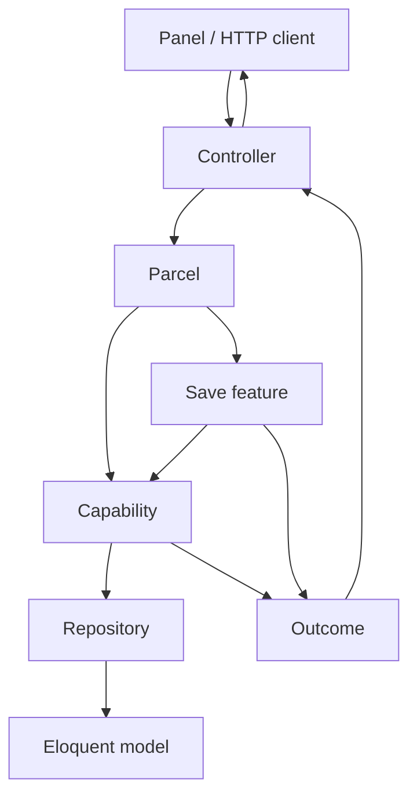

# Architecture: Ugarit Geography Artifact

Geography follows Artifact-Driven Architecture. A **capability** does one operation on one record. A **feature** composes capabilities. HTTP controllers only validate input, build a parcel, and return the outcome.

## Pipeline

Saving a place with its translations is a feature. The same shape is used for country, governorate, city, district, and location:

1. `Save{Entity}Capability` writes the main-table columns.
2. For each locale in the payload, `Save{Entity}TranslationCapability` upserts that locale. A locale sent as `null` is deleted. Omitted locales are left as they are.
3. `Show{Entity}Capability` reloads the record with its translations.

The three steps run in one transaction. A failed step rolls the save back and returns that step's result.

Reading, creating a form, editing, and destroying go straight to a capability. They do not pass through the save feature.

## Where code lives

| Layer | Directory | Responsibility |
| :--- | :--- | :--- |
| **Manifest** | `art.php` | Id `geography`, version `2.00.04`, capability slugs, requires `i18n.translations` |
| **Capabilities** | `src/Capabilities/{Entity}/` | Index, create, show, edit, save, destroy, and translation save/destroy |
| **Features** | `src/Features/{Entity}/` | `Save{Entity}Feature` only |
| **Parcels** | `src/Parcels/` | Typed input for a capability or a feature |
| **Outcomes** | `src/Outcomes/{Entity}/` | Result envelope for that entity |
| **Enums** | `src/Enums/` | Result codes (`SUCCESS`, `FAILED`, and the save-feature variants) |
| **Repositories** | `src/Repositories/` | Eloquent access behind a contract in `src/Contracts/Repositories/` |
| **Policies** | `src/Policies/` | Authorization used by `#[Authorize]` |
| **HTTP** | `src/Http/` | Controllers, form requests, JSON resources |
| **Models** | `src/Models/` | `Country`, `Governorate`, `City`, `District`, `Location` |
| **Schema** | `database/migrations/` | `Schema::createTranslatable()` per entity. See [SCHEMA.md](SCHEMA.md) |
| **Routes** | `routes/web.php` | Loaded by the kernel from the artifact |
| **Language** | `lang/` | `geography::` strings |

`GeographyServiceProvider` is registered from the manifest. The kernel loads config, migrations, translations, views, and `routes/web.php` by convention. The provider does not register extra bindings.

## Invariants

1. Controllers do not query or mutate models. Repositories do.
2. A feature does not write columns itself. It calls capabilities.
3. Translated attributes (`name`, and `address_line` on locations) are not columns on the main table. They are rows in `{singular}_translations`.
4. Models declare `$translatable` and, where a slug exists, `$translatableFallback` so a missing translation can fall back to the slug. `Country` has no slug, so `name` has no fallback column.
