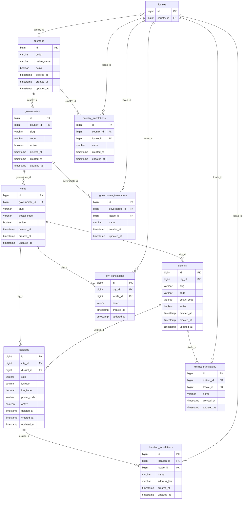

# Database schema: Ugarit Geography Artifact

Five main tables, each created with `Schema::createTranslatable()`. A column marked `translatable()` is **not** stored on the main table. The schema builder moves it to a paired translation table named `{singular}_translations`.

Migrations live in `database/migrations/`:

| Migration | Tables |
| :--- | :--- |
| `2026_10_15_203943_create_countries_table` | `countries`, `country_translations` |
| `2026_10_15_204015_create_governorates_table` | `governorates`, `governorate_translations` |
| `2026_10_15_204019_create_cities_table` | `cities`, `city_translations` |
| `2026_10_15_204041_create_districts_table` | `districts`, `district_translations` |
| `2026_10_15_204044_create_locations_table` | `locations`, `location_translations` |

`string` columns are `varchar(255)` unless a length is given. `id` and every `foreignId` are `bigint unsigned`. Coordinates are `decimal`. `timestamps()` and `softDeletes()` are timestamp columns; `deleted_at` is nullable, and so are `created_at` and `updated_at`.

## Hierarchy

Uniqueness ignores soft-deleted rows (`WHERE deleted_at IS NULL`) on PostgreSQL, SQLite and SQL Server:

| Table | Unique among live rows |
| :--- | :--- |
| `countries` | `code` (ISO 3166-1 alpha-2, `varchar(2)`) |
| `governorates` | `(country_id, slug)` |
| `cities` | `(governorate_id, slug)` |
| `districts` | `(city_id, slug)` |
| `locations` | `(district_id, slug)` when a district is set; otherwise `(city_id, slug)` when a city is set; otherwise `slug` alone |

The same slug can exist in two cities, and a soft-deleted `PS` can be created again. MySQL and MariaDB have no partial indexes, so there the same columns are unique across trashed rows as well, and the location predicates cannot be expressed.

`locales` belongs to `ugarit-artifacts/i18n`. Geography does not create it. The i18n locales migration references `countries.id` with `ON DELETE SET NULL`, so a locale may point at a country and that link clears if the country row is removed.

There is **no** database check that `locations.district_id` belongs to `locations.city_id`. Both foreign keys are independent.

## Delete rules

| Relationship | On delete |
| :--- | :--- |
| `governorates.country_id` → `countries` | Restrict. A country with governorates cannot be hard-deleted |
| `cities.governorate_id` → `governorates` | Restrict |
| `districts.city_id` → `cities` | Restrict |
| `locations.city_id` → `cities` | Set null |
| `locations.district_id` → `districts` | Set null |
| `{entity}_translations.{entity}_id` → parent | Cascade. Hard-deleting the parent deletes its translation rows |
| `{entity}_translations.locale_id` → `locales` | Cascade |

Soft delete (`deleted_at`) does not fire these foreign keys. A soft-deleted parent still owns its translation rows. Translation tables have no `deleted_at`; destroying a translation removes the row.

## `countries`

| Column | Type | Null | Constraints |
| :--- | :--- | :--- | :--- |
| `id` | bigint unsigned | no | Primary key |
| `code` | varchar(2) | no | ISO 3166-1 alpha-2. Unique among live rows |
| `native_name` | varchar(255) | no | Name in the country's own language. Not translated |
| `active` | boolean | no | |
| `deleted_at` | timestamp | yes | Soft delete |
| `created_at` | timestamp | yes | |
| `updated_at` | timestamp | yes | |

`name` is translatable. The model lists no fallback column for it.

## `governorates`

| Column | Type | Null | Constraints |
| :--- | :--- | :--- | :--- |
| `id` | bigint unsigned | no | Primary key |
| `country_id` | bigint unsigned | no | Foreign key → `countries.id`, restrict |
| `slug` | varchar(255) | no | Unique with `country_id` among live rows |
| `code` | varchar(255) | yes | |
| `active` | boolean | no | |
| `deleted_at` | timestamp | yes | |
| `created_at` | timestamp | yes | |
| `updated_at` | timestamp | yes | |

`name` is translatable and falls back to `slug` in the model.

## `cities`

| Column | Type | Null | Constraints |
| :--- | :--- | :--- | :--- |
| `id` | bigint unsigned | no | Primary key |
| `governorate_id` | bigint unsigned | no | Foreign key → `governorates.id`, restrict |
| `slug` | varchar(255) | no | Unique with `governorate_id` among live rows |
| `postal_code` | varchar(255) | yes | |
| `active` | boolean | no | |
| `deleted_at` | timestamp | yes | |
| `created_at` | timestamp | yes | |
| `updated_at` | timestamp | yes | |

`name` is translatable and falls back to `slug`.

## `districts`

| Column | Type | Null | Constraints |
| :--- | :--- | :--- | :--- |
| `id` | bigint unsigned | no | Primary key |
| `city_id` | bigint unsigned | no | Foreign key → `cities.id`, restrict |
| `slug` | varchar(255) | no | Unique with `city_id` among live rows |
| `code` | varchar(255) | yes | |
| `postal_code` | varchar(255) | yes | |
| `active` | boolean | no | |
| `deleted_at` | timestamp | yes | |
| `created_at` | timestamp | yes | |
| `updated_at` | timestamp | yes | |

`name` is translatable and falls back to `slug`.

## `locations`

| Column | Type | Null | Constraints |
| :--- | :--- | :--- | :--- |
| `id` | bigint unsigned | no | Primary key |
| `city_id` | bigint unsigned | yes | Foreign key → `cities.id`, **set null** |
| `district_id` | bigint unsigned | yes | Foreign key → `districts.id`, **set null** |
| `slug` | varchar(255) | no | Unique inside its district, else its city, else on its own. Live rows only |
| `latitude` | decimal(10, 8) | yes | −90 to 90 |
| `longitude` | decimal(11, 8) | yes | −180 to 180 |
| `postal_code` | varchar(255) | yes | |
| `active` | boolean | no | |
| `deleted_at` | timestamp | yes | |
| `created_at` | timestamp | yes | |
| `updated_at` | timestamp | yes | |

`name` and `address_line` are translatable. Both fall back to `slug`.

`city_id` is declared `nullable()` in the migration, same as `district_id`.

## Translation tables

`country_translations`, `governorate_translations`, `city_translations`, `district_translations`, and `location_translations` share one shape. `{entity}_id` is `country_id`, `governorate_id`, `city_id`, `district_id`, or `location_id`.

| Column | Type | Null | Constraints |
| :--- | :--- | :--- | :--- |
| `id` | bigint unsigned | no | Primary key |
| `{entity}_id` | bigint unsigned | no | Foreign key → parent `id`, cascade |
| `locale_id` | bigint unsigned | no | Foreign key → `locales.id`, cascade |
| translated columns | varchar(255) | no | See the table below |
| `created_at` | timestamp | yes | Translation rows keep their own timestamps |
| `updated_at` | timestamp | yes | |

Unique index on (`{entity}_id`, `locale_id`): one row per place per locale.

| Table | Translated columns |
| :--- | :--- |
| `country_translations` | `name` |
| `governorate_translations` | `name` |
| `city_translations` | `name` |
| `district_translations` | `name` |
| `location_translations` | `name`, `address_line` |

### Locale column

`createTranslatable()` asks the active locale resolver which column to add:

- With i18n bound (the supported setup; this artifact requires `i18n.translations`): `locale_id`, a foreign key to `locales`, cascade on delete.
- Without that resolver: a `locale` string of length 10, indexed, storing the locale code itself. No foreign key.

Migrations must run while the i18n resolver is bound, or the translation tables will be created with `locale` instead of `locale_id`.

## What this schema does not store

The capability text in `art.php` mentions capitals, currencies, dialing codes, and flags. Those are not columns. A country is `code`, `native_name`, `active`, and a translated `name`. Coordinates are two nullable decimals, not a geometry column, and there is no boundary polygon. A district is not forced by a foreign key to match `locations.city_id`; `SaveLocationCapability` rejects a district from another city and copies the district's city when `city_id` is omitted.
